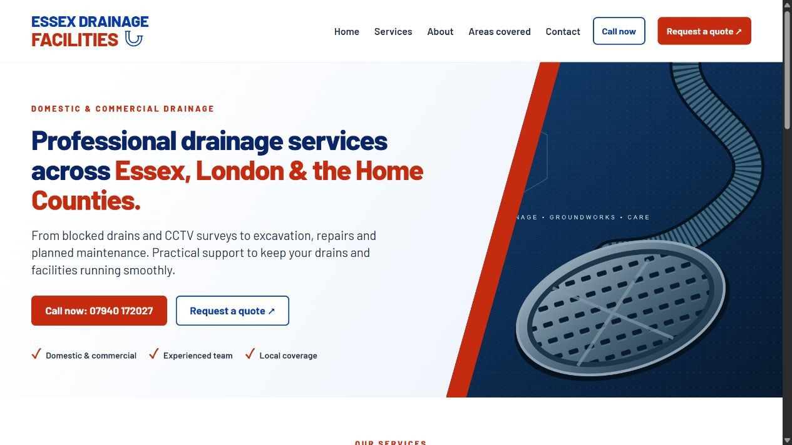

# Grayford portfolio

A standalone portfolio snapshot with a fresh history. The production repository and its private development history are not included.

A responsive website for an independent digital-services business, built by Dave Langstead with AI-assisted development.

[View the website](https://grayford-digital.vercel.app/) · [Dave's GitHub profile](https://github.com/davidmlangstead-dot)

## Project overview

Grayford explains website, automation and Microsoft/cloud services through six pages: Home, Services, Work, About, Contact and Privacy. It is a separate project from Rivetway and from the client website featured on its Work page.

## My role and use of AI

I directed the project requirements, content and feature iteration using AI development tools. This repository demonstrates that AI-assisted workflow alongside the resulting implementation and regression tests; it is not a claim that every line was written manually.

## What the code demonstrates

- Shared HTML templates and a small Node.js static-site build.
- Responsive CSS, mobile navigation, labelled form fields and accessible status messages.
- A contact endpoint with input validation, signed expiring challenges, server-side bot verification and provider idempotency.
- Tests for contact validation, failure handling and form behaviour.
- Canonical URLs, a sitemap and deployment configuration.

The contact handler and tests are useful starting points for reviewers: [handler](lib/contact.mjs), [contact tests](tests/contact.test.mjs), [form tests](tests/form.test.mjs). Tests use synthetic data and mocked email delivery; they do not establish live inbox delivery or a complete security audit.

## Featured project screenshot



This is the Essex Drainage Facilities example shown within Grayford, not a screenshot of Grayford itself. Visit the website above to see Grayford's design.

## Run locally

Node.js 22 or newer. Run `npm ci` before building. BotID provides hosting-specific bot verification; esbuild bundles the browser entry.

```sh
npm ci
npm run build
npm test
npm start
```

Open http://127.0.0.1:4173. Six generated pages: Home, Services, Work, About, Contact, Privacy; also a custom 404. Source content and shared templates are in `scripts/build.mjs`; browser assets in `public/`.

## Preview on Vercel

Build: `npm run build`; output: `dist`; framework: Other. Deploy a `codex/` branch as a preview. The public site at https://grayford-digital.vercel.app/ allows search indexing and publishes `/sitemap.xml`. Canonical links use this address. No production custom domain is configured.

## Private contact form

The recipient address must only be stored in server-side `CONTACT_TO`. Never use public-prefixed variables, mailto links, or client-side recipient configuration. `CONTACT_FROM` must use a verified sender domain. Set `RESEND_API_KEY` to a separate sending-only key for Grayford and `CONTACT_SIGNING_SECRET` to a random secret. These are never included in generated HTML, CSS or JavaScript.

The endpoint validates inputs and origin, bounds messages, uses a signed expiring challenge, a honeypot, provider idempotency and a best-effort instance-local rate limit. It does not send automatic replies to visitors. Provider errors are replaced with generic messages. Missing configuration fails closed with HTTP 503. Check inbox delivery before claiming the form works.

Every valid submission now requires BotID Basic server verification, with development bypass explicitly disabled and errors failing closed. The client attaches the managed challenge. Provider idempotency is keyed only to the signed challenge, preventing changed messages from obtaining new delivery keys with the same token. The instance-local limit remains best-effort; a durable platform rate limit is still useful defence in depth. Finalise privacy wording and retention policy before launch.

## Future Azure Static Web Apps production

The frontend is portable static HTML; `npm run build` produces `dist/`, including `staticwebapp.config.json`. The contact form uses the hosting-specific BotID client and server adapter. Replace both with an Azure-compatible managed anti-bot provider before migrating.

Create an isolated Azure Static Web App only after approval; app location `/`, output `dist`. Port the thin API adapter in `api/contact.js` to an Azure HTTP Function while retaining `lib/contact.mjs`, or configure a separate protected backend. Set new server-side secrets in Azure and rerun enquiry tests. Do not deploy the Vercel adapter unchanged as an Azure function. Production must have its own approved domain, privacy review, abuse controls and indexing settings.

## Project example

The only external project link is https://essex-drainage-facilities.vercel.app/. The project image is an actual homepage screenshot captured on 7 November 2026, linked to the live example. Refresh the capture when the client site changes. No unverified performance claims, testimonials or qualifications are included.


